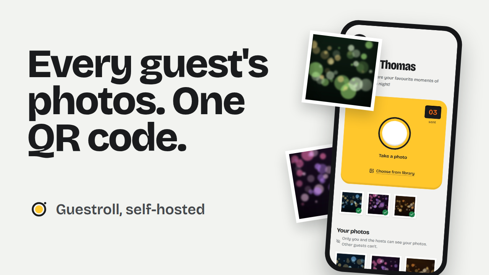

<div align="center">


# Guestroll

**Les photos de tous vos invités, au même endroit.**
Les invités scannent un QR code, l'appareil photo s'ouvre, et chaque photo arrive dans votre album privé.
Auto-hébergé. Sans appli à installer, sans compte à créer.

[English](README.md) | [Documentation](docs/README.md) (en anglais)


</div>

---

À un mariage, un anniversaire ou une soirée d'entreprise, les meilleures photos
restent dispersées sur cent téléphones et ne sont jamais partagées. Guestroll
règle ça avec un QR code sur chaque table :

1. **Scanner.** Le téléphone ouvre une page web, pas un store.
2. **Photographier.** L'appareil photo s'ouvre directement. Un appui, la photo part.
3. **C'est tout.** Elle est dans votre album, avec le prénom de l'invité, prête à être téléchargée en ZIP.

Vous l'hébergez vous-même, avec une commande Docker. Les photos ne quittent
jamais votre machine.

## La vidéo de présentation

<a href="https://youtu.be/MEuvBB-wVI8"></a>

## Fonctionnalités

**Pour les invités**
- L'appareil photo s'ouvre dès le scan, sur iPhone comme sur Android.
- Les envois tiennent sur une 4G faible : photo réduite sur le téléphone, file d'attente, nouvel essai, reprise au retour du réseau.
- Un compteur de poses, comme sur un appareil jetable, quand l'organisateur fixe une limite.
- Chaque invité ne voit que ses propres photos. L'album appartient aux organisateurs.
- Anglais, français, italien et espagnol, selon la langue du téléphone, modifiable sur la page.
- Thème clair et thème sombre.

**Pour les organisateurs**
- Autant d'évènements que voulu, chacun avec son lien, son QR code, sa couleur et son logo.
- Code d'accès facultatif, pour qu'un QR code partagé sur les réseaux ne suffise pas.
- Modération : publier tout de suite et masquer ensuite, ou valider chaque photo.
- **Mur en direct** : diaporama plein écran des nouvelles photos, pour un projecteur.
- **Designer de QR code** : couleurs, forme des points et des coins, logo au centre, légende. Chaque préréglage est testé au scanner.
- Affiche A4 à imprimer, export PNG jusqu'à 4096 px et SVG.
- Fermeture programmée des envois, limite de photos par invité, langue par album.
- ZIP de tout l'album en un clic, diffusé en flux (même pour plusieurs Go).
- Statistiques : envois dans le temps, vues, téléchargements, stockage, meilleurs photographes.

**Pour qui héberge**
- Un seul conteneur, multi-architecture (`amd64`, `arm64` : un Raspberry Pi suffit).
- Pas de base externe : SQLite et un dossier de fichiers dans un seul volume.
- Privé par conception : aucune photo n'est un fichier public, chaque requête est vérifiée. Voir [Sécurité](docs/security.md).
- **Composant de capture remplaçable** : votre propre interface photo, sans toucher à l'envoi. Voir [Personnalisation](docs/customization.md).
- Tout se règle par variables d'environnement : port, chemin des données, `PUID`/`PGID`, fuseau horaire, limites.

## Démarrage rapide

```bash
docker run -d --name guestroll \
  -p 3000:3000 \
  -v guestroll-data:/data \
  -e ADMIN_PASSWORD='un-mot-de-passe-long' \
  -e PUBLIC_URL='https://photos.example.com' \
  -e DEFAULT_LOCALE=fr \
  ghcr.io/achedon12/guestroll:latest
```

Ouvrez `http://localhost:3000/admin`, connectez-vous, créez un évènement et imprimez son QR code.

> [!IMPORTANT]
> Les navigateurs mobiles n'ouvrent l'appareil photo que sur une page **HTTPS**.
> Placez Guestroll derrière un reverse proxy avec un certificat avant
> l'évènement : le [guide de déploiement](docs/deployment.md) donne des
> configurations prêtes pour Caddy, Traefik et nginx.

Vous préférez Compose ? Copiez `.env.example` en `.env`, ajustez-le, puis `docker compose up -d`.

## Documentation

La documentation complète est en anglais dans [docs/](docs/README.md) : installation,
déploiement, configuration, guide admin, personnalisation, sécurité, architecture, API.

## Contribuer

Les issues et pull requests sont les bienvenues, traductions comprises. Lisez
[CONTRIBUTING.md](CONTRIBUTING.md) avant de commencer.

Si Guestroll a sauvé les photos de votre mariage, une ⭐ aide d'autres personnes à le trouver.

## Licence

[MIT](LICENSE) © achedon12
