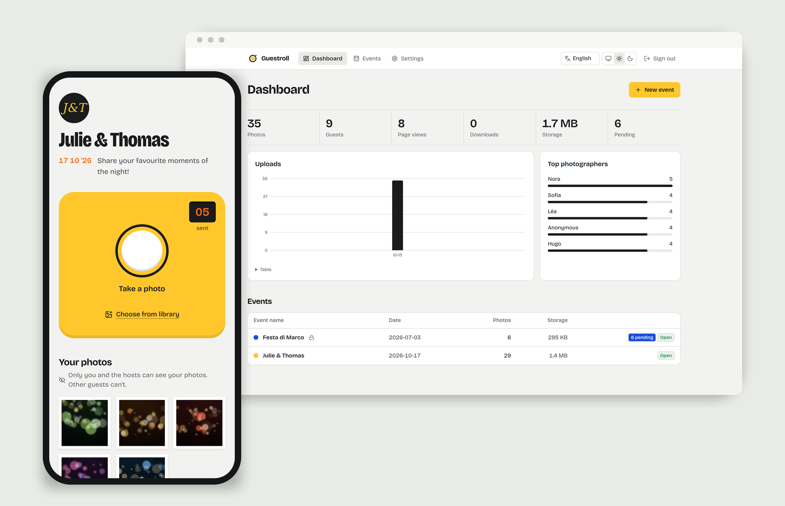
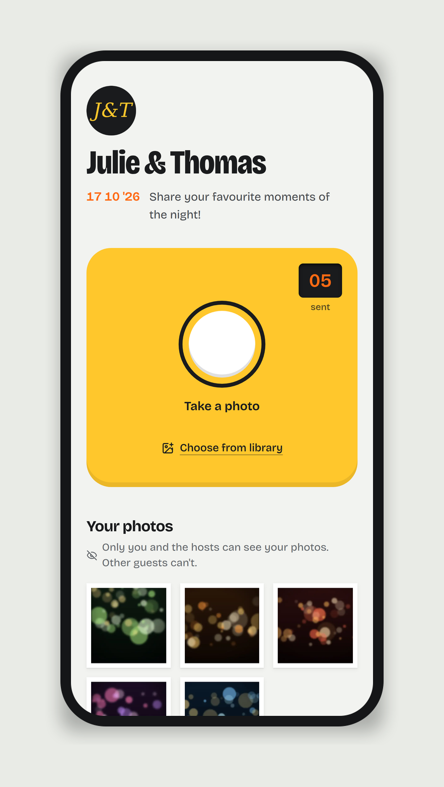
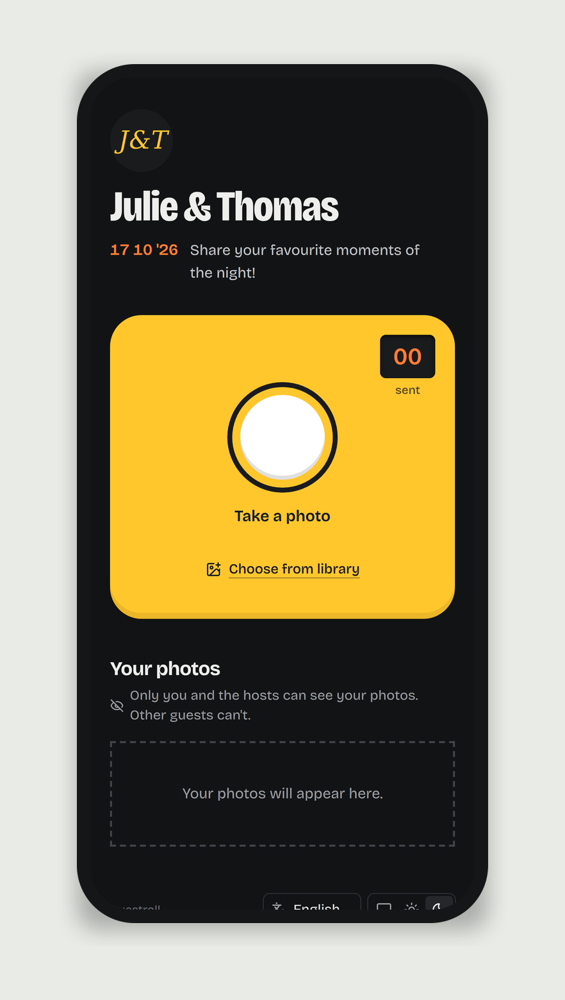
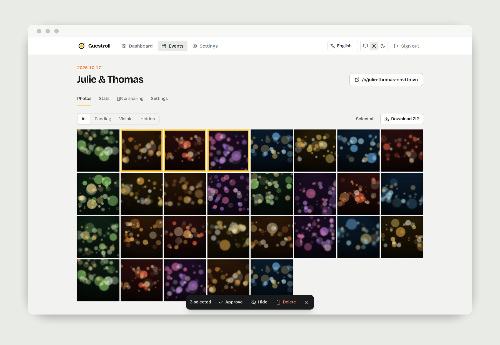
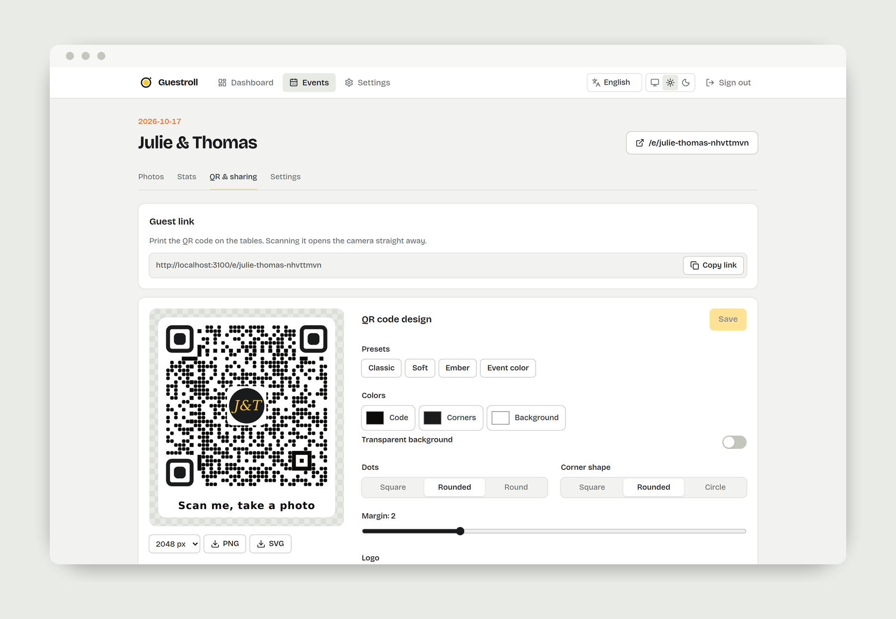
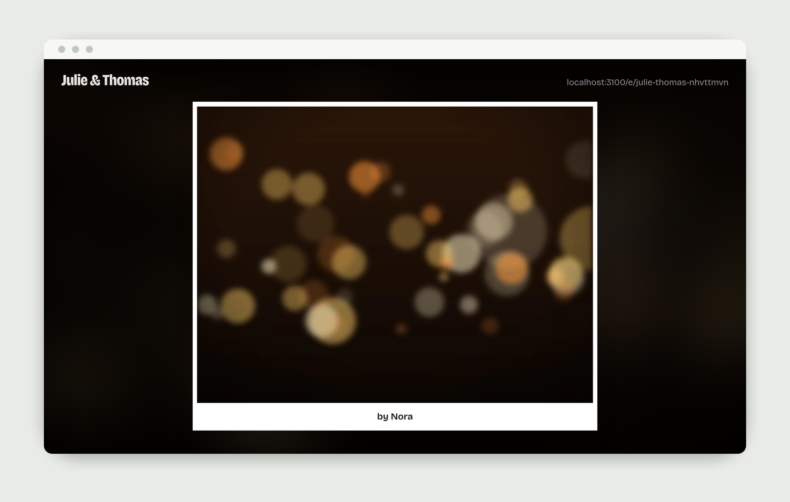

<div align="center">


# Guestroll

**Every guest's photos, in one place.**
Guests scan a QR code, their camera opens, and every picture lands in your private album.
Self-hosted. No app to install, no account to create.

[](https://github.com/achedon12/guestroll/actions/workflows/ci.yml)
[](https://hub.docker.com/r/achedon12/guestroll)
[](https://hub.docker.com/r/achedon12/guestroll)
[](LICENSE)

[Quick start](#quick-start) | [Features](#features) | [Documentation](docs/README.md) | [Français](README.fr.md)



</div>

---

At a wedding, a birthday or a company party, the best photos end up scattered
across a hundred phones and never get shared. Guestroll fixes that with one QR
code on each table:

1. **Scan.** The guest's phone opens a page, not an app store.
2. **Shoot.** The camera opens straight away. One tap, and the photo is sent.
3. **Done.** It's in your album, with the guest's name, ready to download as a ZIP.

You run it yourself, on your own server, with one Docker command. The photos
never leave your machine.

## Features

**For guests**
- 📷 Camera opens directly from the QR code. iPhone and Android, no install.
- 🔁 Uploads keep going on a weak 4G connection: resized on the phone, queued, retried, resumed when back online.
- 🙋 Optional name prompt so the hosts know who took what.
- 🔒 Guests only ever see their own photos. The album belongs to the hosts.
- 🌍 English, French, Italian and Spanish, picked from the phone's language, switchable on the page.
- 🌗 Light and dark themes.

**For hosts**
- 🗂️ As many events as you want, each with its own link, QR code and accent color.
- 🔐 Optional access code per event, so a QR code shared on social media isn't enough.
- ✅ Moderation: publish right away and hide later, or approve each photo first.
- 📺 **Live wall**: a full-screen slideshow of new photos for a projector or TV.
- 🎨 **QR code designer**: colors, dot and corner shapes, your logo in the middle, a caption. Every preset is scan-tested.
- 🖨️ Printable A4 table card, plus PNG (up to 4096 px) and SVG exports.
- 🗣️ A default language per album, for a wedding in Italy with Italian guests.
- ⏰ Uploads close on a schedule, with an optional per-guest photo limit.
- 📦 One-click ZIP of the whole album, streamed (works for albums of several GB).
- 📊 Stats: uploads over time, views, downloads, storage, top photographers.

**For whoever runs the server**
- 🐳 A single container, multi-arch (`amd64`, `arm64`, so a Raspberry Pi works too).
- 🗃️ No external database: SQLite plus a folder of files in one volume.
- 🛡️ Private by design: photos are never public files, and every request is checked. See [Security](docs/security.md).
- 🧩 **Swappable capture component**: ship your own camera UI without touching the upload code. See [Customization](docs/customization.md).
- ⚙️ Configured with environment variables only: port, data path, `PUID`/`PGID`, time zone, limits.

## Quick start

```bash
docker run -d --name guestroll \
  -p 3000:3000 \
  -v guestroll-data:/data \
  -e ADMIN_PASSWORD='choose-a-long-password' \
  -e PUBLIC_URL='https://photos.example.com' \
  achedon12/guestroll:latest
```

Open `http://localhost:3000/admin`, sign in, create an event and print its QR code.

> [!IMPORTANT]
> Phone browsers only open the camera on **HTTPS** pages. Put Guestroll behind a
> reverse proxy with a certificate before the event. The
> [deployment guide](docs/deployment.md) has copy-paste setups for Caddy, Traefik
> and nginx.

Prefer Compose? A ready-to-use [`docker-compose.yml`](docker-compose.yml) is in the repository.
Forgot to set `ADMIN_PASSWORD`? A password is generated on first start and
printed once in `docker logs guestroll`.

## Screenshots

| Guest page | Dark theme | Contact sheet |
|---|---|---|
|  |  |  |

| QR code designer | Live wall |
|---|---|
|  |  |

## Documentation

| | |
|---|---|
| [Getting started](docs/getting-started.md) | Install, first event, the day of the event |
| [Deployment](docs/deployment.md) | Docker, Compose, reverse proxies, HTTPS, backups, upgrades |
| [Configuration](docs/configuration.md) | Every environment variable |
| [Admin guide](docs/admin-guide.md) | Events, moderation, sharing, live wall, stats |
| [Customization](docs/customization.md) | Replace the capture component, theme, translations |
| [Security](docs/security.md) | Threat model and every protection in place |
| [Architecture](docs/architecture.md) | How the code is organised |
| [HTTP API](docs/api.md) | Routes, payloads and error codes |
| [Development](docs/development.md) | Run locally, tests, conventions |

## How it compares

|  | Guestroll | Hosted SaaS apps | Shared cloud album |
|---|---|---|---|
| Price | Free | Paid per event or subscription | Free |
| Your photos stay on | Your server | Their servers | Google / Apple |
| Guests need an account | No | No | Often |
| Camera opens from the QR code | Yes | Yes | No |
| Live wall | Yes | Depends on the plan | No |
| Open source | MIT | No | No |

## Contributing

Issues and pull requests are welcome. Read [CONTRIBUTING.md](CONTRIBUTING.md)
first. It takes two minutes and explains the few rules that keep the project secure.

If Guestroll saved your wedding photos, a ⭐ helps other people find it.

## License

[MIT](LICENSE) © achedon12
